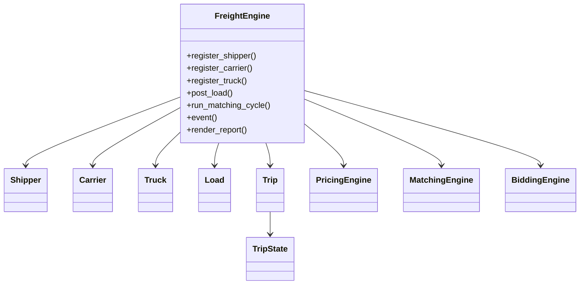
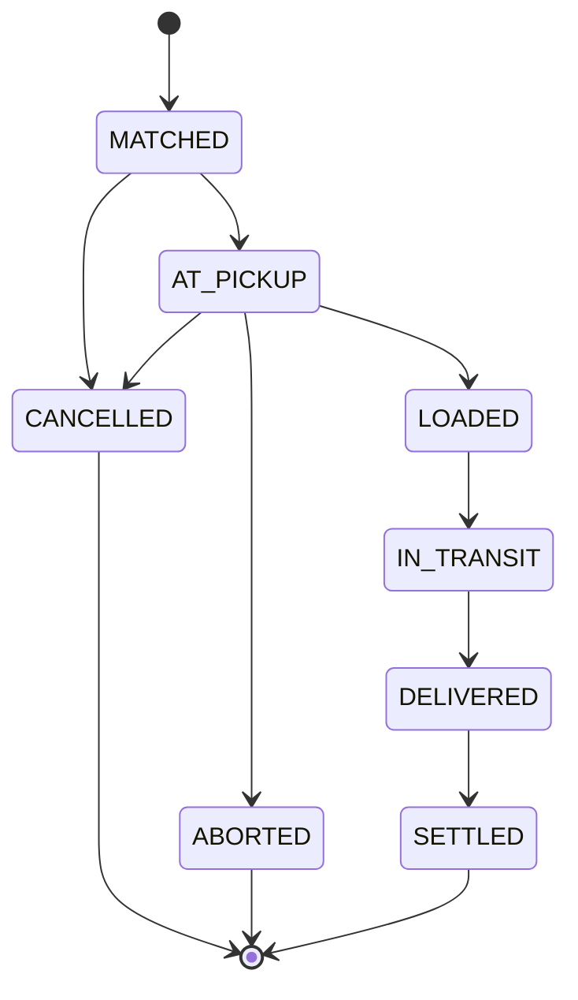

# T069-PS-099 – Freight Exchange Load Matching and Dynamic Truck Pricing Engine
**Implementation:** Python 3.10+ · **Mode:** Command-line, no UI · **Currency:** INR

## 1. Purpose and scope
The application models a freight marketplace: master-data registration, load posting, dynamic lane pricing, truck eligibility/ranking, matching, counteroffers, trip lifecycle, detention, cancellation, settlement, ratings and audit-style output. All demonstration data is embedded in `src/sample_data.py`; there are no required external master-data files.

## 2. Glossary
| Term | Meaning |
|---|---|
| Shipper | Customer posting freight |
| Carrier | Transport provider owning/operating trucks |
| Truck | Capacity/type/length/location/availability/driver-hours resource |
| Lane | Origin-destination city pair |
| Load | Freight request with pickup window and material class |
| Surge | Demand-supply price uplift/discount |
| Backhaul | Potential return load near the first trip's origin |
| Detention | Waiting charge after six free hours |
| TDS | Tax deducted at source |
| RCM | Reverse-charge mechanism indicator printed for registered shippers |
| HOS | Driver hours-of-service restriction |

## 3. Architecture
`main.py` is the CLI entry point. `sample_data.py` creates in-memory data. `engine.py` orchestrates workflows. `pricing.py`, `matching.py`, `bidding.py`, `settlement.py`, `rating.py`, and `validation.py` isolate business logic. `file_handler.py` reads optional JSON command sequences.

## 4. Class diagram

## 5. Trip state diagram

## 6. Business-rule register
| ID | Rule |
|---|---|
| BR-01 | Base freight = max(distance, 150 km) × per-km rate for requested truck type. |
| BR-02 | Unknown city pair is rejected; reverse lookup is permitted for symmetric distance data. |
| BR-03 | Demand-supply ratio = open loads / active available trucks in 200 km radius, by origin and truck type. |
| BR-04 | Strict ratio bands: >4 = +30%; >2.5 = +20%; >1.5 = +10%; <0.5 = -10%; highest applicable band only. |
| BR-05 | Three qualifying return loads within 300 km trigger -8%. |
| BR-06 | Backhaul-poor destination adds +12%. |
| BR-07 | Hazardous adds +15% and requires HAZ certification. |
| BR-08 | Perishable adds +10%; pickup window may not exceed six hours. |
| BR-09 | Oversize length greater than truck length is rejected for that truck. |
| BR-10 | Capacity must meet load weight; truck type exact or one size larger. |
| BR-11 | Truck must be available by pickup-window end and within 150 km of origin (inclusive). |
| BR-12 | Driver remaining hours must cover estimated time to origin plus two-hour buffer; second-driver flag waives the individual-driver rejection. |
| BR-13 | Eligible ranking: distance ascending, carrier rating descending, truck ID ascending; offer top three. |
| BR-14 | Carrier response timeout is 30 minutes; unanswered offer passes onward. |
| BR-15 | Counteroffer ≤15% above recommendation is permitted; >15% rejected. |
| BR-16 | Counter ≤5% auto-accepted; >5% to 15% requires shipper response within 60 minutes. |
| BR-17 | Pickup and delivery each have six free detention hours; remaining time rounds up to the hour. |
| BR-18 | Detention rates: LCV ₹300, 17–22 ft ₹500, MXL/trailer ₹800 per chargeable hour; 48-hour cap. |
| BR-19 | After 48 hours carrier may abort, receiving full capped detention plus 50% of base price. |
| BR-20 | Shipper cancellation before AT_PICKUP: ≤1 hour free; >1 to ≤6 hours ₹1,000; thereafter 10% base. |
| BR-21 | Carrier cancellation after acceptance: ₹2,000 penalty and rating -0.2; pickup-window-end no-show is treated as carrier cancellation. |
| BR-22 | Carrier settlement includes freight, detention and toll; toll capped at lane toll table +10%. |
| BR-23 | Platform fee = 6% of base price, deducted from carrier. |
| BR-24 | Shipper invoice includes freight, toll, detention and 5% GST on freight; RCM flag is printed for GST-registered shipper. |
| BR-25 | TDS = 1% when trip carrier payout >₹30,000 or annual cumulative payout >₹1,00,000. |
| BR-26 | Daily driver limit is 14 hours; trip estimate = km/40 +1 hour; second driver can be flagged. |
| BR-27 | Carrier starts at 4.0; on-time +0.05; >4-hour late -0.1; cancellation -0.2; clamp 1.0–5.0. |
| BR-28 | Carrier rating below 3.0 excludes carrier from ranking. |
| BR-29 | Multi-drop stop pricing is an optional stretch goal, not part of baseline. |
| BR-30 | Fuel index adjustment is an optional stretch goal, not part of baseline. |

## 7. Ambiguities and explicit implementation decisions
1. Surge, return-load, backhaul-poor and material adjustments are added as percentage points on base price, then rounded once to the nearest rupee. This avoids compounding-order ambiguity.
2. Demand supply counts open loads from the same origin and type, and active trucks of that type within 200 km. A zero-truck denominator is treated as zero ratio when no loads exist and a very high ratio when demand exists.
3. “One size larger” follows the configured order LCV → 17FT → 22FT → 32FT_MXL → TRAILER. Rate remains the requested load type's rate.
4. Estimated driver-hours eligibility includes travel-to-origin and the two-hour buffer. The separate trip-duration estimate is `km/40 + 1` and is available for extension into trip scheduling.
5. Cancellation at exactly one hour is free; exactly six hours is ₹1,000. The rule uses elapsed minutes since match.
6. TDS threshold wording uses strict “above”, so exactly ₹30,000 and exactly ₹1,00,000 do not trigger TDS until crossed.
7. The problem statement does not supply a lane toll table or toll-file schema. The baseline uses actual toll when no lane cap is configured; a lane cap can be supplied in `load.price_breakdown['lane_toll_cap']`.
8. The prompt describes a “carrier may respond within 30 minutes” and “passes to next truck”; this version deterministically selects the top ranked truck for the automated demo. The ranked top-three offers are logged; production event-driven offer-response orchestration is a known extension.
9. A second driver is represented by a carrier-level boolean.
10. GST is calculated on freight only as specified; RCM is a printed flag, not a tax remittance engine.

## 8. Input and output
Run `python main.py`. Optionally pass `--commands commands.json`; the JSON file is a sequence of `ADVANCE`, `MATCH`, `COUNTER`, and `EVENT` commands. The report is printed and written to `outputs/run_report.txt`.

## 9. Testing
Run `python -m unittest discover -s tests -v`. Tests cover minimum distance, unknown lane rejection, exact surge threshold, 150 km eligibility, exact 5% counter, detention rounding, exact one-hour cancellation, exact HOS buffer, rating bounds, counter rejection, perishable window and hazardous certification.
