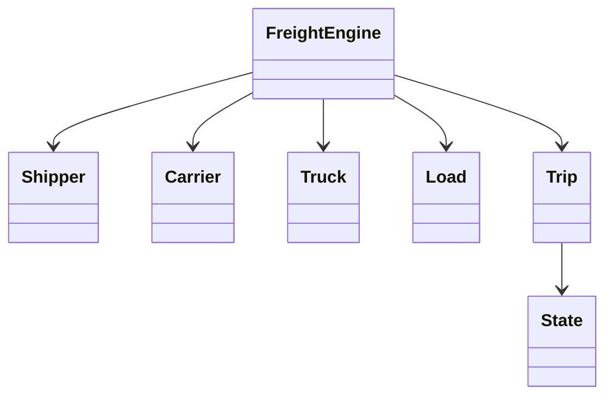
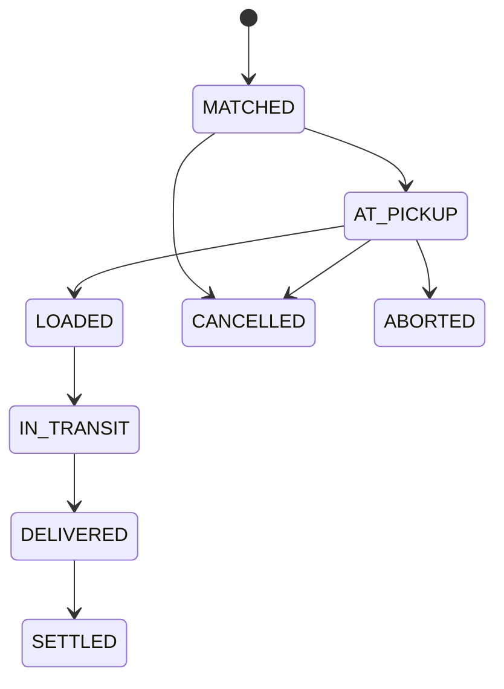

# T069-PS-099 Design Document

## 1. Purpose
Implement a command-line freight marketplace engine covering shipper/carrier/truck registration, load posting, dynamic pricing, matching, bidding, trip state, settlement and ratings.

## 2. Glossary
| Term | Definition |
|---|---|
| Shipper | Customer posting a freight load |
| Carrier | Transport company operating trucks |
| Truck | Vehicle with type, capacity, length, location and driver availability |
| Lane | Origin-destination city pair |
| Surge | Price modifier from open-load to available-truck ratio |
| Backhaul | Return load from destination towards original origin |
| Detention | Waiting charge after free waiting allowance |
| TDS | Tax deducted at source |
| RCM | Reverse-charge indicator printed for registered shipper |
| HOS | Driver hours-of-service |

## 3. Architecture
`main.py` is the CLI. `sample_data.py` creates the in-memory master data. `engine.py` orchestrates operations. `rules.py` contains pricing, eligibility, settlement and rule calculations. `file_handler.py` reads optional JSON command files.

## 4. Class diagram

## 5. Trip state diagram

## 6. Business rule register
| ID | Business rule |
|---|---|
| BR-01 | Base price = max(distance, 150 km) × requested truck-type rate. |
| BR-02 | Unknown city-distance pair rejects the load price calculation. |
| BR-03 | Demand-supply ratio = open loads / active same-type trucks within 200 km of origin. |
| BR-04 | Ratio >4: +30%; >2.5: +20%; >1.5: +10%; <0.5: -10%; highest band only. |
| BR-05 | At least 3 qualifying return loads of same type from destination, with their destinations within 300 km of original origin, deduct 8%. |
| BR-06 | Destination in backhaul-poor list adds 12%. |
| BR-07 | Hazardous adds 15% and truck must have HAZ certification. |
| BR-08 | Perishable adds 10%; pickup window must be no longer than 6 hours. |
| BR-09 | Oversize load longer than truck is ineligible. |
| BR-10 | Truck capacity must cover weight; exact or one-size-larger truck type allowed. |
| BR-11 | Truck available by pickup-window end and within 150 km of origin, inclusive. |
| BR-12 | Remaining driver hours must cover distance-to-origin / 40 plus 2-hour buffer; second-driver flag waives single-driver rejection. |
| BR-13 | Rank by distance ascending, rating descending, truck ID ascending; top 3 offered. |
| BR-14 | Carrier offer expires after 30 minutes; next ranked truck is offered. |
| BR-15 | Carrier counter up to 15% above recommended price; above 15% rejected. |
| BR-16 | Counter up to 5% auto-accepted; >5% to 15% awaits shipper decision for 60 minutes. |
| BR-17 | Six free detention hours at pickup and delivery; remaining time rounded up separately. |
| BR-18 | Detention ₹300 LCV, ₹500 17–22 ft, ₹800 MXL/trailer per hour, max 48 hours per detention period. |
| BR-19 | After 48 hours carrier may abort; full capped detention and 50% base compensation apply. |
| BR-20 | Shipper cancel before AT_PICKUP: within 1 hour free; up to 6 hours ₹1,000; thereafter 10% base. |
| BR-21 | Carrier cancel after acceptance: ₹2,000 and rating -0.2; pickup-end no-show treated likewise. |
| BR-22 | Carrier freight receipt includes freight, toll and detention; toll capped at lane table +10%. |
| BR-23 | Platform fee = 6% of base, deducted from carrier. |
| BR-24 | Shipper invoice = freight + toll + detention + 5% GST on freight; print RCM flag if registered. |
| BR-25 | TDS 1% if payout >₹30,000 per trip or annual cumulative payout >₹1,00,000. |
| BR-26 | Driver cannot exceed 14 hours/day; trip estimate = km/40 +1; second-driver flag supported. |
| BR-27 | Carrier starts 4.0; on-time +0.05; >4-hour late -0.1; cancellation -0.2; clamp 1.0–5.0. |
| BR-28 | Rating below 3.0 removes carrier from ranking. |
| BR-29 | Multi-drop per-stop pricing is optional stretch goal, not baseline. |
| BR-30 | Monthly fuel-price index adjustment is optional stretch goal, not baseline. |

## 7. Important edge conditions
- 149 km charges as 150 km.
- Exactly 1.5 ratio has no surge.
- Exactly 150 km truck-origin distance is eligible.
- Exactly 5% counter is auto-accepted.
- 6 hours 1 minute detention charges one hour.
- Exactly 1 hour shipper cancellation is free.
- Exactly enough driver hours including buffer is eligible.
- Annual payout trip crossing ₹1,00,000 triggers TDS.

## 8. Assumptions
The assignment does not define machine-readable organizer file formats, whether lane distance is directed, or exact report serialization. This implementation treats city distances as symmetric, adds modifiers additively, and uses JSON command events with minutes as the clock. Confirm these assumptions against organizer samples when supplied.
